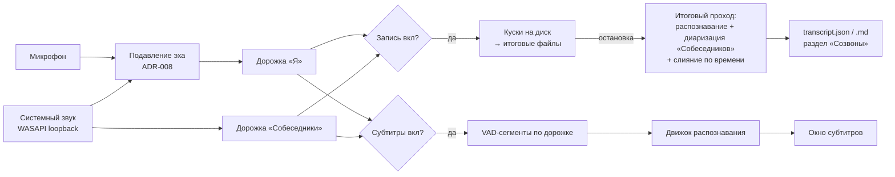

# Режим созвона в Voicen, релиз 1 — концепт версии

21.10.2026. Решения владельца отмечены (В). Вопросы ВВ-1…ВВ-6 отвечены 21.10.2026 (`tz.md`, разд. 10).

## 1. Зачем

Владелец созванивается по работе (с заказчиком, командой) и проходит собеседования. Сейчас разговор не сохраняется. Договорённости остаются в памяти, вопросы на чужом языке иногда не разобрать на слух.

Релиз 1 даёт:
1. **Запись созвона без бота:** звук собеседников из динамиков и свой голос из микрофона прямо на ПК — в любом приложении: Telegram, Zoom, Meet, Teams, браузер.
2. **Расшифровку по говорящим:** кто что сказал.
3. **Живые субтитры диалога** поверх экрана во время разговора.

Готовый транскрипт и аудио лежат в папке и готовы для агентов. Итоги созвона по шаблонам «рабочий созвон» и «собеседование» входят в релиз (Should, ВВ-3). Письма и задачи в трекерах — в следующих релизах.

**Сценарии владельца (В):**
- рабочие созвоны — например, с заказчиком;
- собеседования.

**Пользователи:** сначала владелец. Voicen — публичный open-source, поэтому функция доступна всем пользователям Voicen (В, ВВ-1).

## 2. Границы релиза 1

| Входит | Не входит (следующие релизы) |
|---|---|
| Режим созвона: переключатели «Запись» и «Субтитры» в любом сочетании (В) | Перевод в субтитрах — релиз 2 (В) |
| Захват системного звука (динамики) и микрофона — две раздельные дорожки | Синхронный перевод голосом, клон голоса |
| Диаризация: «Я» и «Собеседник 1…N» (В: диаризация обязательна) | Узнавание собеседников по имени (голосовые профили) |
| Живые субтитры диалога поверх экрана | ИИ-ассистент с подсказками во время созвона |
| Итоговый транскрипт после остановки: точнее живых субтитров, с говорящими и временем | Письма и задачи в трекерах агентом |
| Итоги созвона кнопкой «Итоги» по шаблонам «рабочий созвон» и «собеседование» на постобработке LLM — Should (В, ВВ-3) | — |
| Список созвонов: просмотр транскрипта, переименование говорящих, экспорт в Markdown и JSON, открыть папку, удалить | Интеграции: календарь, почта, трекеры, ecosystem-bots |
| Определение языка по каждой реплике; настройка «основной язык» — заготовка для перевода в релизе 2 | macOS, Linux, мобильные |
| Windows 10/11 x64, как весь Voicen | Своя комната встреч, звонилка |

### Порядок поставки (решение владельца 21.10.2026)

Релиз поставляется частями:
1. **1a** — запись и чтение: API-движок, роли по дорожкам;
2. **1b** — субтитры;
3. **1c** — диаризация собеседников;
4. **1d** — локальные движки, эхо, итоги, плеер.

Начинается после публикации релиза диктовки Voicen. Подробности — `tz.md`, разд. 11.

## 3. Режим созвона

Два независимых переключателя (В) дают три рабочих сочетания:

| «Запись» | «Субтитры» | Что происходит |
|---|---|---|
| вкл | выкл | Пишутся обе дорожки. После остановки — итоговый транскрипт с говорящими. Окна субтитров нет |
| выкл | вкл | Окно субтитров показывает диалог в реальном времени. **На диск ничего не пишется**, после остановки ничего не остаётся (В: «ничего не сохраняется») |
| вкл | вкл | Пишутся обе дорожки и показываются субтитры. После остановки — итоговый транскрипт |
| выкл | выкл | Режим созвона выключен |

**Как включать (П):**
- меню в трее «Созвон» с двумя галочками и пунктом «Остановить»;
- отдельная глобальная горячая клавиша режима созвона: включает режим с последним сочетанием переключателей и выключает его;
- окно субтитров и индикатор записи с кнопками переключателей.

Переключатели можно менять **на ходу**. Пример: включил запись, потом добавил субтитры; выключил субтитры — запись продолжается. Запись нельзя «добавить задним числом» к уже прошедшему разговору.

**Диктовка во время созвона** работает как обычно (В, ВВ-4).

## 4. Как это выглядит

- **Индикатор записи** (на основе готового оверлея диктовки). Пока идёт запись, видно, что она идёт: значок трея в состоянии записи и маленький индикатор «● Запись 12:34» поверх окон, перемещаемый. В начале записи индикатор напоминает: «Предупредите собеседника о записи» и подсказывает «лучше в наушниках» (ADR-010). В индикаторе — уровни звука обеих дорожек: видно, что собеседник слышен (ВФ-16).
- **Окно субтитров:**
  - поверх всех окон, не перехватывает фокус;
  - перетаскивается, меняет размер, полупрозрачное;
  - режим «клики насквозь» включается кнопкой;
  - показывает последние 2–4 реплики с подписью «Я» / «Собеседник»;
  - текущая реплика появляется через несколько секунд после окончания фразы;
  - размер шрифта и прозрачность — в настройках.
  
  В живых субтитрах собеседники подписываются по дорожке: «Я» — микрофон, «Собеседник» — динамики. Номера собеседников (1, 2, …) появляются только в итоговом транскрипте после диаризации (ADR-005).
- **После остановки записи:**
  - уведомление «Созвон сохранён, расшифровка…»;
  - затем «Транскрипт готов» с кнопкой «Открыть».
- **Раздел «Созвоны»** в окне приложения:
  - список созвонов: дата, длительность, название (по умолчанию «Созвон ДД.ММ ЧЧ:ММ», можно переименовать), состояние расшифровки;
  - **просмотр:** реплики по времени с цветом и подписью говорящего, переименование говорящего («Собеседник 1» → «Коллега») для этого созвона, поиск по тексту, проигрывание аудио с выбранной реплики (П, Should);
  - **кнопки:** «Копировать транскрипт», «Экспорт Markdown / JSON», «Открыть папку», «Расшифровать заново», «Удалить».

## 5. Поток данных

**Ключевая идея разметки (ADR-003).** Раздельные дорожки решают половину диаризации даром:
- всё с микрофона — «Я»;
- всё из динамиков — собеседники.

Диаризация нужна только внутри дорожки динамиков, если собеседников несколько.

## 6. Что и где хранится (ADR-009)

Папка созвона — `%LOCALAPPDATA%\Voicen\calls\<ГГГГ-ММ-ДД_ЧЧММСС>\`. Внутри:
- `mic.opus` и `system.opus` — две дорожки;
- `transcript.json` — реплики: начало, конец, дорожка, говорящий, язык, текст;
- `transcript.md` — читаемый вид;
- `meta.json` — время, длительность, устройства, движки, версия приложения, имена говорящих.

Правила:
- режим «только субтитры» на диск ничего не пишет;
- логи никогда не содержат текст и звук (правило Voicen).

## 7. Что дальше (контекст, не для релиза 1)

- **Релиз 2:** перевод в субтитрах. Если язык реплики не совпадает с основным языком приложения, под ней показывается перевод (В).
- **Дальше по концепту (общий концепт владельца (вне репозитория)):**
  - ассистент в созвоне;
  - итоги и задачи агентом;
  - интеграции;
  - голосовые профили;
  - синхронный перевод голосом.
- **Архитектура закладывается под ядро и нишевые оболочки** (исследование рынка и подходов владельца (вне репозитория)): захват, распознавание, говорящие и хранение — отдельные модули с интерфейсами (ADR-011).
