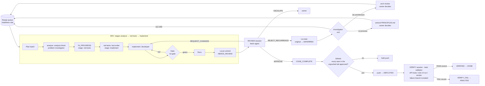

# Sessions

Work happens in short sessions of four kinds (plus an occasional architecture review with the owner). Each has one job, a fixed exit and a fresh context. DEV is itself three stages — analyze, red-tests, implement — that can each run in a session of their own (§8).
Splitting them is what makes review real and pushes safe.

## 0. Starting and resuming

`/teamwright:flow` is the entry point for every working session in Claude Code; `/teamwright:router` does one step of it per session, and the stage commands one named stage (§8). It asks the router (`tw-next.py --json` in the plugin, see `lifecycle.md` §4; other runtimes run `python3 <kit>/scripts/tw-next.py --json`) for the next action, shows a one-screen status, and runs the matching session below — DEV, REVIEW, DRAIN or VERIFY — with fresh role subagents. It asks the owner only at decision points (task choice when asked, large work → spec tool, escalation and recurrence exits (b)/(c), push, `NEEDS_OWNER`), stops on escalation, a `TEAMWRIGHT_PAUSE` file or its budget (`--tasks N`, default 1), and ends with a summary and an `Outcome:` line.

After an interruption — tracked changes left in the tree, or a session that ended `interrupted` — the next session gets `resume` with the stage the router derived from the task record (its `stage:` field checked against the evidence), and finishes it from the record, `git status`, the diff and the last `chore(task)` commit — never from a previous session's memory. Changes in the tree that do not belong to the task are left alone and reported. A task left at a stage on a clean tree is not interrupted: it goes on at its recorded stage.

## 1. Who does what

| Session | Actor | Does | Never does |
|---|---|---|---|
| **DEV** | orchestrator with role subagents: `problem-investigator`, `test-writer`, `developer`, `technical-writer` | Pick batch → `ANALYSIS`: investigator fills `analysis` → `IN_PROGRESS` at `stage: red-tests` (analysis gate) → test-writer: red tests → `stage: implement` → developer: implement until green → failure-branch bite → gate → technical-writer: docs → orchestrator: local commit, `NEEDS_REVIEW`. In one session, or one stage per session (§8): `IN_PROGRESS` crosses a session boundary when its `stage:` is recorded and the tree is clean | Push; mark its own work reviewed |
| **REVIEW** | `code-reviewer` subagent, fresh context (spawned by the orchestrator, never a fork of the author) | Read diff + task + principles + failures; run the gates the task's changes need (`scripts/tw-gate --for-task <ID>`, then `scripts/tw-gate <area>` for each; a cached PASS counts; exit 75 → the same command again); detect recurrence (opening the `rca` task file); write the review record `docs/tasks/<ID>.reviews/<n>.md` with one verdict | Edit code, tests or docs — every finding, however small, goes back to DEV; change task statuses; review code it wrote |
| **DRAIN** | orchestrator | Push only when every task referenced in the unpushed tail is `CODE_COMPLETE`, `DEPLOYED`, `VERIFIED` or `DONE` (or carries `tail_code: ratified`); flip to `DEPLOYED` | Push selectively (a push ships the whole tail) |
| **VERIFY** | `task-validator` agent, fresh context | Run the verification suites per `surface` against the running system (API tests; end-to-end UI run with the configured UI runner; deploy smoke), failure branch included; write the verify record `docs/tasks/<ID>.verify/<n>.md`; acceptance check (DoD evidence, mutations) | Edit code or tests to make a run pass; accept a happy-path run, an interactive exploration or the system's own text as proof |
| **ARCH-REVIEW** (on demand) | orchestrator + owner, `/arch-review` | For a recurrence whose exit is (b): options with trade-offs from hotspots and seams; owner decision into `docs/decisions.md`; follow-up spec/plan or tasks | Decide for the owner; start implementation in the same session |
| **Owner** | human | Decides forks, approves escalations, breaks review loops | Rubber-stamp; the owner is a decision point, not a reviewer of every diff |

Self-review never counts. An internal quality check inside DEV is allowed and useful, but it does not replace REVIEW.

## 2. Outcome contract

Every session ends with exactly one outcome, written in its final message. The session-end hook journals it, with the session's tool calls, into `.teamwright/logs/` — metrics and routing read the journal, not the message:

| Outcome | Meaning |
|---|---|
| `barrier` | Work done, committed locally; next session type is determined |
| `idle` | Ready queue empty — nothing to pick |
| `escalate` | Nothing at all can proceed without the owner (global block, not one blocked task) |
| `interrupted` | Stopped mid-step (owner interrupt, a role agent that crashed without a result, context limit near) — written by the session when it still can; a session cut off without a final message is journaled as `none`, and the router resumes the current task either way |

One blocked task is **not** `escalate`: mark it `BLOCKED` with a reason, report it, keep picking other ready tasks.
A stage session also writes `Stage: <analyze | red-tests | implement | review | verify>` (a flow run: `Stage: flow`) and `Batch: <ids> - <why these>` above the `Outcome:` line; the hook journals them as `stage`, `batch` and `batch_reason`, taking the last such lines of the message (the end block; an earlier quoted one does not count). A flow session runs several stages in one context and is journaled as `flow`: the Stop hook sees one session and its cumulative tokens, with no boundary between the stages inside it, so per-stage numbers come from stage sessions (`/teamwright:router`, the stage commands, one stage per CI job).
A session that ends without an outcome is a defect in the process — the next session cannot route. The `Outcome:` line is the last line of the final message, in plain text; the Stop hook reads it from the message, or from the transcript when the runtime does not pass the message. A session does no other work while a role agent it spawned is still running: role agents run in the foreground, and each result is committed before the next step. When the runtime runs a role in the background and has no blocking wait, the turn ends with a "waiting for <role>" line and no outcome; the hook journals `waiting`, and the completion notification resumes the session. Only the session's last turn counts as its outcome.

## 3. Passes: how many tasks in a row

A **pass** is one `/teamwright:flow` run that takes tasks from the ready queue one after another, in this working tree. How many is a project setting (`process.batch` in `.teamwright/config.yml`, changed by the owner through `/teamwright:settings`); the pipeline each task goes through is the same.

| Rule | Why |
|---|---|
| **At most `batch.max_tasks` tasks per pass** (default 1, at most 5) | Each task still gets its own diff, review and records; the cap bounds the context a session carries |
| **Capped per priority: `batch.by_priority`** (default P0 1, P1 1, P2 3, P3 3) | A pass that holds a P0 stays at one task; the lowest cap among the pass's tasks wins |
| **One task `IN_PROGRESS` at a time per working tree** | One `.teamwright/current-task` per tree. Analysis may run ahead — an analyze session may analyse several tasks — but the next task enters `IN_PROGRESS` only when the previous one left it (`NEEDS_REVIEW` or later); until then it waits in `ANALYSIS` with its analysis committed, and the router does not offer it (`state.wip_waiting`). A send-back to `IN_PROGRESS` is not held |
| **Parallel: separate worktrees and sessions** (`batch.parallel`, default 1 = off) | `/teamwright:parallel` analyses ready tasks in the main tree, groups those whose `analysis.seam` paths do not overlap (a seam without a path runs alone), and gives each a worktree on `tw/<ID>` and its own session. Each branch is rebased, gated in its worktree and fast-forwarded into the main branch one at a time; one push afterwards |
| **A red gate stops the pass** | Nothing new is started on a broken tree |
| **Checked by the router** | `tw-next.py --pass <ids taken so far>` reports `budget` and answers `stop` instead of `start` when the cap is used; the flow does not count from memory |
| `--tasks N` lowers the cap for one run | Never raises it above the setting |

`process.autonomy`: `start: auto` starts the router's ready task without asking which one; `continue: true` keeps the pass going after a barrier instead of ending the session. Push stays a decision point: with `continue: true` it is asked once, at the end of the pass, for every task the pass brought to `CODE_COMPLETE`.

## 4. Stop and check with the owner

Stop the session (outcome `escalate` or a `BLOCKED` task + question) when:
- the task needs a product decision or a fork between approaches with different costs;
- review has returned the task twice in a row (two `REQUEST_CHANGES` records): the third record is `ESCALATE` or `REJECT_RECURRENCE`;
- an `rca` task itself shows a recurrence;
- the fix requires rewriting a function marked dangerous in `CLAUDE.md` / `docs/decisions/`;
- the change touches secrets, auth, money, data deletion or migrations and the task did not say so;
- the canon requires something the tools don't allow (see `principles.md` §3) — report the gap, don't route around it silently;
- the investigator recommends exit (b) architecture review or (c) process amendment for a recurrence (`lifecycle.md` §6) — both are owner decisions;
- verification cannot be automated for a task (`kind: manual` needs a `verify_exception` the owner accepts).

Record the owner's answer in `docs/decisions.md` (proposed-by: agent / decided: owner).

## 5. Model by task class

| Task class | Model tier |
|---|---|
| DEV or REVIEW on a risky seam (concurrency, data writes, auth, money, contracts, migrations, known hotspots) | Strongest available |
| REVIEW of any task with a recurrence flag | Strongest available |
| DEV on isolated, well-specified feature work | Mid tier |
| Docs sync, formatting, status flips, log summarisation, search | Cheap tier is fine |

The model is fixed in each role file's front matter (`model:`), and the orchestrator picks the role file by the task's class (type, priority, seam) — not by asking for a model in the prompt text. A model requested in prose is a hint that can silently fall back to a weaker default; a role file per class is a fact. Defaults in `.claude/agents/`: `problem-investigator`, `code-reviewer`, `task-validator`, `developer`, `test-writer` — `opus`; `technical-writer` — `sonnet`. For a cheaper developer on isolated work, copy the role file (e.g. `developer-light.md`) with another `model:` and route that class to it.

**Model per stage** (`process.models.<stage>` in the config, changed through `/teamwright:settings`): the stage commands, the router and the flow pass the stage's model as the `model` parameter of every role spawn of that stage (Claude Code's agent tool takes it over the role file's `model:`) — a tool parameter, not a request in the prompt. The technical-writer keeps its own file's model. Unset → the role files decide, as above. In an autonomous run the job also starts the session itself with that model (`claude -p … --model <model>`, §8).

A cheap model is **not** used for DEV or REVIEW of risky seams. If you find yourself adding deterministic scaffolding to make a cheap model behave on a critical step, the tier is wrong — raise it instead.

## 6. Context hygiene

- Start each session cold from the task record and the map (`CLAUDE.md`), not from a previous session's memory.
- Read the area file in `docs/decisions/` **before** editing that area.
- Keep tool output short (head/tail, counts); large dumps crowd out the task.

## 7. The VERIFY session

Run after DRAIN for every task that reached `DEPLOYED` (and for `deploys: false` tasks with `surface` `api` / `ui` / `both`, against a locally started system). The router holds to it: a `CODE_COMPLETE` task that deploys is offered for verify only once its code is on the delivery branch (`<remote>/HEAD`, `/main` or `/master` of the delivery remote — the current branch's upstream remote, else the only remote, else `origin`), merged or squashed, rebased or cherry-picked there; before that, the push decision names it.

1. **Start cold** from the task record: `surface`, Acceptance (especially the failure branch), `verify_exception`, the latest review record.
2. **Smoke the deploy:** the service answers and runs the pushed commit (version endpoint or startup log). A green pipeline is not proof.
3. **Run the suites** that `surface` requires — `api` → the API test suite against the running service; `ui` → an end-to-end UI test run with the configured UI runner ([tools.md](tools.md)); `both` → both; `none` → the smoke alone. The failure-branch input from Acceptance must be among the executed tests.
4. **Check the effect in data or logs**, not in the UI text or the API's own success message.
5. **Write one record per run** — `docs/tasks/<ID>.verify/<n>.md` from `docs/tasks/_verify-template.md`, with Edit/Write (the verify gate refuses shell writes): `task`, `round`, `kind`, `tool`, `command`, `environment`, `commit`, `result`, `evidence` (the report / junit / trace the run produced), `verifier`, and a `Failure branch:` line in the body. Never edit an earlier round — a re-run is the next round. Add one line per round to the task's `## Verification` section.
6. **Acceptance check** in the same pass: DoD evidence, the task's mutant catalog and targeted mutations on a throwaway copy (`task-validator`, `scripts/tw-mutants`), appended to `## Validation`.
7. **Outcome:** all records `PASS` for the current commit → orchestrator sets `VERIFIED`, then `DONE`. Any `FAIL` → `VERIFY_FAIL` → `ANALYSIS`: a failed verification means the analysis missed something; it is not patched in the VERIFY session.

Interactive tools (a browser or device MCP, an emulator, a REPL against the API) help to explore and to reproduce; the evidence is always a committed test executed by its runner. A missing end-to-end test for the failure branch is a finding for `test-writer`, not a reason to verify by hand.

## 8. Stages: one stage per session

The lifecycle is five stages. Each can run in a session of its own, with a fresh context and a model of its own; the router (`tw-next.py`) decides which stage runs now and on which tasks.

| Stage | Command | Takes | Roles | Leaves the task |
|---|---|---|---|---|
| analyze | `/teamwright:analyze` | ready `TODO`, `ANALYSIS`, `VERIFY_FAIL` | `problem-investigator` | `IN_PROGRESS` at `stage: red-tests`; or `BLOCKED` / a decision point |
| red-tests | `/teamwright:red-tests` | `IN_PROGRESS` at `red-tests` | `test-writer` (first spawn: red tests, bite check, mutant catalog) | tests committed, `stage: implement` |
| implement | `/teamwright:implement` | `IN_PROGRESS` at `implement` | `developer`, `test-writer` (failure-branch bite, `tw-mutants`), `technical-writer`; `tw-gate --for-task` + `tw-gate <area>` | local commit, `NEEDS_REVIEW`. A failed check is fixed in the same session |
| review | `/teamwright:review` | `NEEDS_REVIEW` | a fresh `code-reviewer` per task, one at a time | `CODE_COMPLETE` / `IN_PROGRESS` (`stage: implement`) / `DEFERRED` / `BLOCKED` |
| verify | `/teamwright:verify` | `CODE_COMPLETE`, `DEPLOYED`, `VERIFIED` | a fresh `task-validator` | `DONE` / `IN_PROGRESS` / `VERIFY_FAIL` / owner |

Push (DRAIN) is not a stage: it stays the owner's decision (`decide`). `/teamwright:router` asks the router and runs exactly one stage; `/teamwright:flow` loops router steps in one session; a stage command runs its named stage and refuses, naming the right command, when the router says the task is elsewhere.

**The `stage:` field.** Inside `IN_PROGRESS` the task record carries `stage: red-tests | implement`, written by the stage that finished its work and committed with that work: analyze sets `red-tests` with the move to `IN_PROGRESS`, red-tests sets `implement` with the tests, review or verify set `implement` (or `red-tests`, when the finding is about the tests) when they send a task back. The router checks it against the evidence — `## Tests` filled means the red tests are written. A field *behind* the evidence wins: `stage: red-tests` with the tests filled is a task sent back to its tests, a legal step back. A field *ahead* of the evidence loses: `stage: implement` with no tests goes to red-tests, with a warning. A task without the field (started before stages) is routed by the evidence alone. The analysis gate holds the order, with evidence: entering `IN_PROGRESS` sets the stage (`red-tests` from `TODO`/`ANALYSIS`; a send-back may set `implement`), the field is never cleared, `implement` needs `## Tests` filled, and `IN_PROGRESS → NEEDS_REVIEW` needs `stage: implement`, the tests and, for a task that changes code, the `### Failure branches` table — not with `analysis: skipped:trivial` (`gates.md`, analysis gate check 4).

**One task `IN_PROGRESS` per working tree** still holds (§3): a stage session takes its tasks one after another, and makes each the active one by editing its record first. Analyze and review sessions may cover several tasks the same way, but an analyze batch moves only one task into `IN_PROGRESS`; the others keep their committed analysis in `ANALYSIS` until the tree's `IN_PROGRESS` task reaches `NEEDS_REVIEW`. Parallel work stays in separate worktrees (§3).

**Selection.** `process.router.select` decides who picks the tasks:

- `script` (default) — `tw-next.py` does the selection by status, the readiness rule and the counting, and prints, for the stage it chose, the `candidates` in router order with the facts a batch choice needs: priority and effective priority, how many open tasks each unblocks, `depends_on`, the seam's paths and the areas they fall in, size hints (seam paths, Acceptance items, review rounds), the other candidates it `overlaps` (tw-parallel's seam rule; a seam with no path overlaps everything) and the candidates it depends on. The session reads no task file to find work.
- `agent` — the session reads `docs/tasks/*.md` itself and applies the readiness rule (`lifecycle.md` §4) and the stage rule above to find the tasks of the stage; the router still decides pause, resume, which stage is due and whether there is work, but its output has no `candidates` and no `batch` (also not in `request`, unless the command names its tasks) and `command` carries no ids. Costs tokens on every session; worth it only when the task records carry something the script cannot read (another format, a tracker export).

**Choosing the batch** (both modes). Take at most `batch_cap` tasks (`process.stages.<stage>.batch`), one after another. The router's `batch` is the default — the first candidates in its order. Deviate when the facts say so, and say why in one line: tasks whose seams and areas do not overlap and that do not depend on each other can follow one another without one invalidating the other's work; tasks in the same area share context, which makes a batch cheaper; a candidate that depends on another candidate goes after it, or waits. Write the result in the end block: `Batch: T-3 T-7 - disjoint seams, both in the server area`.

**Thresholds** (`process.stages.<stage>`). The router runs a stage while other work exists only when it is due: at least `min` tasks wait there, a P0/P1 task (effective priority) waits, or the oldest waiting task's record is older than `max_wait_hours` (its last commit; the file's modification time when the record is uncommitted or has uncommitted changes). Thresholds only **hold a stage back**; they do not rank the due stages by queue length — among due work the router's decision order decides (`plugin.md`, the router). A stage that is not due moves behind the due work; when nothing else is due, it runs (`work_available` is the one predicate for both). Defaults `batch: 1`, `min: 1`, `max_wait_hours: 0` — every stage runs at once, one task per stage session, as before stages. Example: `review: {batch: 3, min: 2, max_wait_hours: 4}` reviews in sessions of up to three, waits for a second task unless one is P0/P1 or waited four hours.

**The protocol of a stage command** — in short, the file stage sessions read: [stage-protocol.md](stage-protocol.md) (under 4 KB, so a stage session does not load this whole section). The router answer they read is `tw-next.py --brief`: `request` first, at most a few compact candidates, counts instead of the task list (closed tasks are never listed, also not in the full `--json`).

1. Ask: `tw-next.py --brief --stage <stage> [--task <ids>]`. `request.ok` false → show `request.hint` (the command to run instead: another stage, finishing the work left in the tree, the pause), do nothing else, end with `Outcome: idle`. An explicit stage command ignores `min`; it never skips unfinished work in the tree.
2. Choose the batch from `request.candidates` (above).
3. Per task, one after another: the stage's work. Role agents run in the foreground and each result is committed before the next step (`/teamwright:flow`, session rules); every status change is its own commit; the stage field changes with the commit that finishes the stage's work. Decision points (`/teamwright:flow` §5) are asked when reached; a blocked task does not stop the batch.
4. End block — the summary, then `Stage: <stage>`, `Batch: <ids> - <why>` and, as the last line, `Outcome: barrier | idle | escalate | interrupted` (§2).

**Autonomous runs: one stage per job.** Every job starts from git and the task records, runs one stage and ends: an interrupted job loses one stage, not the task, and each stage gets its own model. `tw-next.py --json` gives the job what it needs in `headless` (`run`, `prompt`, `model`, `stage`, `task`, `decisions`, a note). An owner decision (an escalation, a blocked question, `NEEDS_OWNER`) does not stop the chain while other work is available: the job takes the first piece of work in router order and reports the decisions; `run` is false only when nothing is left that a job can do without a person (a push, a start with `autonomy.start: ask`), the team is paused, or the tree holds uncommitted changes of no task. The prompt carries no task ids: the stage session asks the router and picks its batch from the candidates, within the stage's cap. Between jobs the commits travel on a `wip/` branch, which pre-push does not treat as a delivery; DRAIN to the main branch stays the owner's. On such a branch the router counts unpushed commits against the delivery branch (its own upstream is even after each job's push), so the push decision is asked, and a task that deploys is verified only after the push. An example workflow is in the kit's user guide (`docs/usage.md`, *Autonomous runs*); the real workflow lives in the project.
